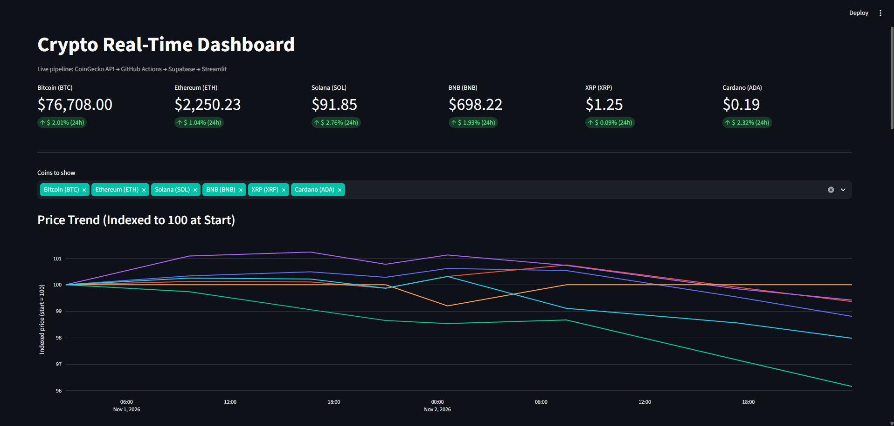

# Crypto Real-Time Dashboard


End-to-end data pipeline: a Python script pulls live market data for six major
cryptocurrencies from the CoinGecko API, stores a snapshot in a Supabase
(PostgreSQL) database on a GitHub Actions schedule through GitHub Actions, and a Streamlit
dashboard visualizes price trends, correlations, and volatility over time.

**Live demo:** https://crypto-realtime-dashboard.streamlit.app/



## Key Findings

Window: 2026-09-24 to 2026-11-04 (about 41 days, 6 coins, 204 snapshots).
Volatility and correlation use 41 daily returns per coin.

- **All six coins fell.** Bitcoin fell the least (-4.8%) and Cardano the most
  (-20.6%), roughly four times as much. In between: BNB -7.6%, ETH -10.0%,
  XRP -15.0%, SOL -18.7%.
- **Higher volatility went with bigger losses.** Ranking the coins by daily
  volatility (BTC 1.44%, BNB 1.72%, ETH 1.92%, XRP 2.07%, SOL 2.09%, ADA 3.22%)
  gives the same order as ranking them by loss, from smallest to largest.
  Cardano's daily volatility was about 2.2 times Bitcoin's.
- **The coins moved together.** Every pair had a daily return correlation between
  0.68 and 0.91. BTC and ETH were the most closely linked (0.91) and ADA and BTC
  the least (0.68), which is still strongly positive.
- **Deepest drawdowns** from the highest observed price: ADA -32.4%, SOL -25.9%,
  XRP -23.4%, ETH -20.1%, BNB -12.9%, BTC -11.7%.

**Caveats**
- One window in a falling market. The link between volatility and losses is an
  observation across six coins, not a general rule, and says nothing about rising markets.
- Daily close is the last snapshot of each UTC day. Snapshots are irregular (about
  5 per day), so the spacing between closes varies and adds noise to volatility
  and correlation estimates.
- Drawdowns are measured on sampled snapshots, so intraday lows may be deeper.
- The pipeline is scheduled every 30 minutes, but GitHub Actions delivered about one
  run every 5 hours, so hourly or time-of-day analysis is not supported by this data.
- Descriptive analysis only, not a forecast or investment advice.

## Architecture

```
CoinGecko API → src/ingest.py → Supabase (PostgreSQL) → dashboard/app.py (Streamlit)
                      ↑
         GitHub Actions cron (every 30 min)
```

## Tracked Coins

Bitcoin (BTC), Ethereum (ETH), Solana (SOL), BNB (BNB), XRP (XRP), Cardano (ADA)

## Metrics Collected

- Current price (USD), market cap, market cap rank
- 24h trading volume, 24h high and low
- Price change % over 1h, 24h, and 7d
- Circulating supply
- All-time high (ATH) and % distance from ATH

## Dashboard Features

- KPI cards with current price and 24h change per coin
- Indexed price trend (start = 100) to compare coins fairly regardless of price scale
- Raw price per coin in separate panels
- Distance from all-time high (horizontal bar chart)
- 24h trading volume on a log scale with readable tick labels (10M to 100B)
- Price correlation matrix (heatmap of returns)
- Rolling volatility (standard deviation of returns, adjustable window)
- Latest snapshot table with all metrics
- Dark theme configured through `.streamlit/config.toml`

## Tech Stack

| Layer | Tools |
|---|---|
| Ingestion | Python 3.11, requests 2.34.2 |
| Database | Supabase (PostgreSQL), psycopg2-binary 2.9.13 |
| Automation | GitHub Actions (cron) |
| Dashboard | Streamlit 1.64.0, Plotly, pandas |
| Configuration | python-dotenv 1.2.3 |

All dependency versions are pinned in `requirements.txt`.

## Project Structure

```
Crypto_Realtime_Dashboard/
├── .github/workflows/fetch_data.yml   # Scheduled ingestion
├── .streamlit/config.toml             # Dashboard theme
├── dashboard/app.py                   # Streamlit app
├── docs/dashboard.png                 # Screenshot
├── sql/schema.sql                     # Table definition
├── src/
│   ├── config.py                      # Coins, API URL, table name
│   ├── db.py                          # Database connection and inserts
│   └── ingest.py                      # CoinGecko fetch and parse
├── .env.example
├── .gitignore
├── requirements.txt
└── README.md
```

## Design Decisions

- **Indexed prices:** Bitcoin trades at a much higher price than the other coins and
  flattens them on a shared axis. Indexing every coin to 100 at the start of the
  window shows relative performance instead.
- **Log scale for volume:** trading volumes differ by orders of magnitude, so a log
  axis with custom tick labels keeps small coins visible.
- **Connection pooler (port 6543):** suited to short-lived connections like the ones
  GitHub Actions creates on every run.
- **Least privilege:** ingestion uses a role that can write, while the public
  dashboard connects with a read-only role limited to `SELECT` on `crypto_prices`.
- **Cached queries:** the dashboard caches database reads for 5 minutes to limit load.
- **No extra tables for analytics:** correlation and volatility are computed from the
  stored price snapshots using percentage returns.

## Local Setup

1. Clone the repo and install dependencies:
   ```powershell
   git clone https://github.com/EdwinChen18/Crypto_Realtime_Dashboard.git
   cd Crypto_Realtime_Dashboard
   python -m venv .venv
   .venv\Scripts\Activate.ps1
   pip install -r requirements.txt
   ```
   On macOS or Linux, activate with `source .venv/bin/activate`.
2. Create a free Demo API key at [coingecko.com/en/api](https://www.coingecko.com/en/api).
3. Create a Supabase project and run `sql/schema.sql` in the SQL Editor.
   Copy the Transaction pooler connection string (port 6543).
4. Copy `.env.example` to `.env` and fill in both variables:
   - `SUPABASE_DB_URL`
   - `COINGECKO_API_KEY`
5. Test the ingestion script:
   ```powershell
   python -m src.ingest
   ```
   Expected output: `Inserted 6 rows for coins: bitcoin, ethereum, solana, binancecoin, ripple, cardano`
6. Run the dashboard:
   ```powershell
   streamlit run dashboard/app.py
   ```

## Automation

`.github/workflows/fetch_data.yml` runs `src/ingest.py` every 30 minutes with
GitHub Actions. GitHub treats scheduled runs as best-effort, so the observed cadence is lower. 
Add these repository secrets under Settings > Secrets and variables > Actions:

- `SUPABASE_DB_URL`
- `COINGECKO_API_KEY`

To trigger a run manually and check its status:

```powershell
gh workflow run fetch_data.yml
gh run list --workflow=fetch_data.yml --limit 5
```

## Deployment

The dashboard is deployed on Streamlit Community Cloud with `dashboard/app.py` as the
main file. The only secret it needs is `SUPABASE_DB_URL`, using the read-only database
role. It does not need the CoinGecko key because it only reads from Supabase.

## Engineering Notes

- **API access changes:** CoinGecko started returning `403 Forbidden` for
  unauthenticated requests to the markets endpoint, which broke the scheduled runs.
  Fixed by sending a free Demo API key in the `x-cg-demo-api-key` header, stored as
  a GitHub secret.
- **Silent failures:** a misspelled coin ID is ignored by the API without an error and
  simply returns fewer rows. The ingestion script logs the number of inserted rows to
  make this visible.
- **Outage gap:** runs that failed during the API change left a gap in the stored
  history. Charts show the gap instead of interpolating over it.

## Limitations and Future Work

- Snapshots are taken every 30 minutes, so this is near real-time, not tick-level streaming.
- Add a validation step that fails the run if the returned row count differs from the
  number of tracked coins.
- Price alerts when a coin moves more than a set percentage.
- Forecasting and anomaly detection on the stored history.
- Historical backfill using CoinGecko's market chart endpoint.
- Observed cadence is about 5 snapshots per day.

## Status

- [x] Ingestion script and Supabase schema
- [x] GitHub Actions automation
- [x] Streamlit dashboard with trend, ATH, volume, correlation, and volatility views
- [x] Deployed publicly on Streamlit Community Cloud

## Author

Edwin Chen Liu | [LinkedIn](https://linkedin.com/in/edwin-chen18) | [GitHub](https://github.com/EdwinChen18)